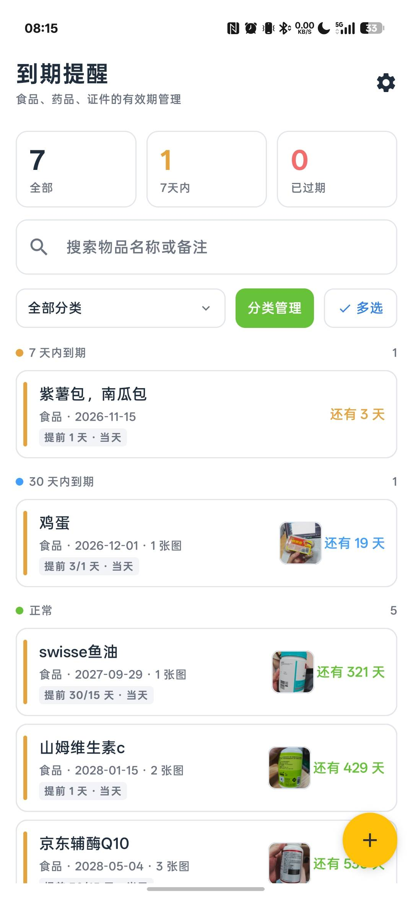

# JExpiryReminder（到期提醒 · Android 原生）

专注「到期提醒」的独立 Android 应用，**Kotlin + Jetpack Compose** 原生实现。



## 构建

```bash
# 环境变量（本机已具备）：JAVA_HOME=.jdks/microsoft-jdk-17，ANDROID_HOME=AppData/Local/Android/Sdk
./gradlew assembleDebug        # 产物 app/build/outputs/apk/debug/app-debug.apk（约 33MB）
./gradlew testDebugUnitTest    # 61 个单元测试
./gradlew installDebug         # 连接设备安装
```

Gradle 走腾讯镜像、Maven 走阿里云镜像，无需代理。

## 功能

- **图像识别录入**：首页「添加」旁的相机按钮 → 拍照 / 相册选图（最多 6 张）→ 确定后本地识别
  → 带着预填结果进添加页；识别名称、生产日期、保质期、「有效期至」，多个候选由用户点选；
  **全程离线**（ML Kit bundled 中文模型 + 已移除库带入的网络权限），照片不离开设备
- **物品管理**：名称 / 分类 / 生产日期 / 有效期（天·月·年，月末自动收敛）/ 到期日
  （可由生产日期+有效期推算，也可手动指定）/ 数量 / 备注；
  新增时默认「食品」，若主页正按某分类筛选则自动预选该分类
- **提醒档位**：提前 60/30/15/7/3/1/0 天，可选多档；另可自定义任意 1~365 天
- **列表**：四档统计卡（已过期/7 天内/30 天内/正常）、搜索、分类筛选（进出编辑页后保留，
  下拉里每项显示该分类记录数）、按状态分组、侧滑删除（带确认）、长按进入多选批量删除
- **分类管理**：内置 5 分类 + 自定义分类，12 色取色板换色（内置分类颜色也可改）；
  分类下还有物品时不允许删除（删除按钮置灰，点击提示原因），删除空分类需二次确认
- **图片**：拍照 / 相册选图，自动等比压缩（最长边 1280，JPEG 85），每件最多 6 张
- **通知**：AlarmManager 精确闹钟（`setExactAndAllowWhileIdle`），关掉应用也会推送；
  开机广播自动重排；精确闹钟权限未授予时自动降级为非精确闹钟 + 前台检查兜底；
  去重键 `<fireDate>:<itemId>:<days>`，FNV-1a 派生稳定通知 id
- **备份**：SAF 导出/导入 zip（data.json + images/ + manifest.json），
  支持「覆盖」与「按 id 合并」两种模式

## 数据格式

- data.json **v5**：`items` / `categories` / `categoryColors`，字段同名同语义
- 图片存相对路径 `images/<id>.jpg`，随备份打包
- v3 的内联 base64 图片加载时自动迁移成文件

## 数据目录

`<内部存储>/files/JExpiryReminder/modules/expiry/`（`data.json` + `images/`）。

## 结构

```
app/src/main/java/com/jimmy/expiryreminder/
├── App.kt / MainActivity.kt      # 入口、导航（Home/Edit/Settings 三屏）、通知权限
├── core/
│   ├── Dates.kt                  # 日期工具（ISO 日期、加月收敛、剩余天数）
│   ├── Models.kt                 # 数据模型 + 容错 JSON 解析 + ExpiryCalc（推算/FNV-1a）
│   ├── ExpiryStore.kt            # 仓库单例（StateFlow + Mutex 落盘、合并逻辑）
│   ├── ImageStore.kt             # 图片落盘/压缩/迁移
│   ├── SettingsStore.kt          # 设置（主题/通知开关/推送时刻）
│   └── Backup.kt                 # zip 打包与解析（java.util.zip + SAF）
├── notify/
│   ├── ReminderService.kt        # 提醒计划计算 + AlarmManager 排程 + 前台兜底
│   └── Receivers.kt              # AlarmReceiver（触发通知）/ BootReceiver（开机重排）
├── ocr/                          # 离线识别（纯逻辑，全部可单测）
│   ├── OcrEngine.kt              # ML Kit 中文识别器封装（单例、串行）
│   ├── TextNormalizer.kt         # 全角/零宽/中文数字日期归一
│   ├── DateExtractor.kt          # 日期正则 + 关键词 + 打分 + 合理性校验
│   ├── NameExtractor.kt          # 版面分析取品名（字号 + 黑名单）
│   ├── ResultMerger.kt           # 多图聚类与合并
│   ├── PrefillMapper.kt          # 合并结果 → 预填草稿
│   └── OcrModels.kt              # OcrLine / 候选 / PrefillDraft
└── ui/
    ├── Theme.kt / Common.kt      # 主题、异步图片加载
    ├── HomeScreen.kt             # 列表页（含识别入口）
    ├── PickImagesScreen.kt       # 选图页（拍照 + 相册，≤6）
    ├── OcrProgressScreen.kt      # 识别进度页
    ├── EditScreen.kt             # 编辑/新增页（支持预填与候选）
    ├── ImageViewer.kt            # 全屏图片查看器
    ├── CategoryScreen.kt         # 分类管理
    └── SettingsScreen.kt         # 设置页
```

## 备注

- minSdk 26（自适应图标需要 v26；如需更低版本需补位图图标）
- **识别零联网**：ML Kit 用 `com.google.mlkit:text-recognition-chinese`（bundled，模型随 APK）；
  依赖会把 `INTERNET` / `ACCESS_NETWORK_STATE` 合并进来，已在 manifest 用 `tools:node="remove"` 移除，
  安装后系统权限列表里没有任何网络权限。不可换成 `play-services-mlkit-text-recognition-chinese`（需联网下模型）
- **APK 体积**：OCR 的 native 库每个 ABI 7–11MB，已用 `ndk.abiFilters` 只保留 `arm64-v8a` + `armeabi-v7a`，
  从 56MB 降到 29MB（release）。代价：x86 模拟器装不上，真机不受影响，需要模拟器调试时临时把 ABI 加回来
- AGP 9.1 内置 Kotlin，构建脚本不单独应用 `org.jetbrains.kotlin.android`
- 相机拍照经 FileProvider（`cache/camera/`）接收，落库前删除临时文件
- 图片压缩：等比缩放至最长边 1280，JPEG 质量 85
