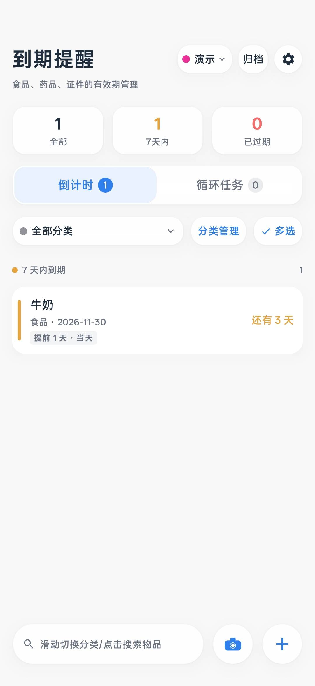

# JExpiryReminder（到期提醒 · Android 原生）

专注「到期提醒」的独立 Android 应用，**Kotlin + Jetpack Compose** 原生实现。



## 构建

```bash
# 环境变量（已写入用户级环境变量）：JAVA_HOME=%USERPROFILE%\.jdks\microsoft-jdk-17，ANDROID_HOME=%USERPROFILE%\AppData\Local\Android\Sdk
./gradlew assembleDebug        # 产物 app/build/outputs/apk/debug/app-debug.apk（约 34MB）
./gradlew testDebugUnitTest    # 115 个单元测试
./gradlew installDebug         # 连接设备安装
```

Gradle 走腾讯镜像、Maven 走阿里云镜像，无需代理。
版本号由 release-please 自动维护，CI 发版签名走根目录 `keystore.properties`（不入库）。

## 功能

- **图像识别录入**：首页「添加」旁的相机按钮 → 拍照 / 相册选图（最多 6 张）→ 确定后本地识别
  → 带着预填结果进添加页；识别名称、生产日期、保质期、「有效期至」，多个候选由用户点选；
  识别前可**框选区域**只识别局部；识别结果按品名关键词**自动归入内置分类**；
  **全程离线**（ML Kit bundled 中文模型 + 已移除库带入的网络权限），照片不离开设备
- **物品管理**：名称 / 空间 / 分类 / 生产日期 / 有效期（天·月·年，月末自动收敛）/ 到期日
  （可由生产日期+有效期推算，也可手动指定）/ 数量 / 备注 / 归档 / 循环任务；
  新增时默认「食品」，若主页正按某分类筛选则自动预选该分类
- **归档**：不常用物品可归档收起；归档页是独立页面（返回键 + 大标题 + 空间筛选 + 分类下拉），
  行左滑「调回」进列表，多选支持批量调回 / 批量删除
- **循环任务**：开启后按「上次完成日 + 周期」推算下一个到期日，完成后自动推进到下一轮；
  支持定点提醒时刻（如每天 09:00）；主页可整页右滑在「倒计时 / 循环任务」两种列表间切换
- **空间归属**：物品归入某个空间（我的空间 / 我的房间 / 公司…），也可以不归属任何空间（「未分配」，新增时默认如此）；
  顶部胶囊切换空间，默认「全部空间」（所有空间 + 未分配一起看），列表、统计卡、分类计数都跟着空间走；
  空间可改名、换色、删除（删除空间不会删除物品，空间里的物品会变成「未分配」）；
  **「全部空间」「我的空间」「未分配」的颜色都可改**，记在 data.json 的 `spaceColors` 里
- **提醒档位**：提前 60/30/15/7/3/1/0 天，可选多档；另可自定义任意 1~365 天；
  分类可设**默认提前提醒天数**，新增物品自动带上
- **列表**：统计卡五档（全部/正常/30 天内/7 天内/已过期），设置页可自定义显示哪几张
  （默认 全部 / 7 天内 / 已过期）；搜索胶囊横滑可切分类；行左滑两段式（第一段可配置动作、
  滑满 = 删除，松手弹确认框）；分类筛选进出编辑页后保留，下拉里每项显示该分类记录数，按状态分组；
  长按进入多选后可批量改**空间**、批量改**分类**、批量分享、批量**归档**、批量删除（带确认），也可一键全选
- **分类管理**：内置 5 分类 + 自定义分类，12 色取色板换色（内置分类颜色也可改）；
  分类下还有物品时不允许删除（删除按钮置灰，点击提示原因），删除空分类需二次确认
- **图片**：拍照 / 相册选图，自动等比压缩（最长边 1280，JPEG 85），每件最多 6 张
- **通知**：`USE_EXACT_ALARM` 安装即授予；「闹钟式提醒」开启时走 `setAlarmClock`
  （抗 Doze 最稳，代价是状态栏闹钟图标），关闭时降级为 `setExactAndAllowWhileIdle` + 前台检查兜底；
  一次最多排 200 条计划，触发后延迟补排让窗口向前滚动；开机广播自动重排；
  去重键 `<fireDate>:<itemId>:<days>` 记在物品的 `notifiedKeys` 里
- **常驻汇总通知**（默认关闭）：可在设置开启一条常驻通知，汇总未来 7 天内要过期的物品
- **备份**：SAF 导出/导入 zip（data.json + images/ + manifest.json），
  支持「覆盖」与「按 id 合并」两种模式
- **跨设备分享**：同一 Wi-Fi 下用 mDNS 自动发现另一台设备 → 发起方生成 4 位配对码，
  对方比对屏幕数字后接受 → 传输选中的物品（含图片），也可在空间下拉里「按空间分享」整空间发送；
  接收方先收到待接收批次，自己选择落到哪个空间（也可现场新建空间，默认「未分配」）后才真正入库；
  **入库前会检查同名物品**，由用户选择「直接新增 / 跳过同名 / 覆盖同名 / 人工逐条挑选」。
  全程局域网 TCP 直连，不经过任何服务器；发送的是副本，本机记录不受影响。
  自动发现被路由器挡住时可手动填对方 IP
- **空间同步**：两台设备协商把同一个空间合并成一份（双向）。发起方选本机空间 → 配对 →
  上传快照；接收方选择自己的哪个空间参与合并 → 本机先合并 → 把合并后的快照回传 → 发起方再合并。
  匹配规则：名称（去空格、忽略大小写）+ 到期日相同视为同一件，同一件以 `updatedAt` 较新的为准；
  只增改、不删除。同样走局域网 TCP，不经过服务器
- **桌面小组件**：小 / 中 / 大三种尺寸，显示提醒总数与物品的剩余天数（状态色），支持紧凑布局；
  点击某行回到主页并定位、高亮该物品
- **桌面快捷方式**：长按应用图标可直达「新增物品 / 拍照识别」

## 数据格式

- data.json **v13**：`items` / `categories` / `categoryColors` / `categoryLabels` / `categoryOrder` /
  `spaces` / `spaceLabels` / `spaceColors` / `revision`，字段同名同语义
- v5 → v6：`items[].spaceId` 缺字段时归内置默认空间（`default`）；`spaceId` 为空串表示「不归属空间」
- v6 → v7：空间颜色覆盖表 `spaceColors`，键是空间 id、「未分配」用 `__unassigned__`、「全部空间」用 `__all__`；
  缺字段时各用内置默认色
- v7 → v8：去掉内置默认空间（未维护的空间读取时视为「未分配」，不改写历史数据）
- v8 → v9：增加物品的 `rev` 修改标记与顶层 `revision` 时钟（同步水位用）；
  分类可设默认提前提醒天数（缺该键即无默认，不做迁移）
- v9 → v10：增加 `syncId` 共同唯一 ID（旧数据缺字段按空读取，首次落盘由 id 派生补发）
- v11：合并分支的落盘标记（语义与 v9/v10 相同）
- v11 → v12：增加物品的 `repeatEnabled` 循环任务标记（旧数据缺字段按 false 读取）
- v12 → v13：增加循环任务的定点提醒时刻 `reminderTime`（旧数据缺字段按空读取）
- 图片存相对路径 `images/<id>.jpg`，随备份打包
- v3 的内联 base64 图片加载时自动迁移成文件

## 数据目录

`<内部存储>/files/JExpiryReminder/modules/expiry/`（`data.json` + `images/`）。
跨设备传输的临时包在 `cache/transfer/`（out 发送、in 接收），收完或离开页面即清理。

## 结构

```
app/src/main/java/com/jimmy/expiryreminder/
├── App.kt / MainActivity.kt      # 入口、自绘导航（AnimatedContent + 返回栈，无 Navigation 库）、
│                                 #   桌面快捷方式、小组件行点击的定位、通知权限
├── core/
│   ├── Dates.kt                  # 日期工具（ISO 日期、加月收敛、剩余天数）
│   ├── Models.kt                 # 数据模型（空间/归档/循环任务/rev/syncId）+ 容错 JSON 解析 + ExpiryCalc（推算/FNV-1a）
│   ├── ExpiryStore.kt            # 仓库单例（StateFlow + Mutex 落盘、合并逻辑）
│   ├── ImageStore.kt             # 图片落盘/压缩/迁移
│   ├── SettingsStore.kt          # 设置（主题/通知开关/推送时刻/统计卡组合/常驻汇总/闹钟式提醒）
│   ├── Backup.kt                 # zip 打包与解析（java.util.zip + SAF）
│   ├── Transfer.kt               # 跨设备物品包（zip 打包 / manifest 解析 / 落库）
│   ├── TransferNet.kt            # 局域网 TCP 服务端 + 客户端 + mDNS 发现
│   ├── TransferManager.kt        # 传输会话（配对码、发送进度、待接收批次）
│   ├── AtomicFiles.kt            # 原子写文件
│   ├── IoLimits.kt               # 读写大小/数量限制
│   └── NameSimilarity.kt / Similarity.kt  # 同名物品匹配（接收入库、空间同步用）
├── notify/
│   ├── ReminderService.kt        # 提醒计划计算 + AlarmManager 排程（setAlarmClock / 精确 / 非精确）+ 窗口滚动补排
│   └── Receivers.kt              # AlarmReceiver（触发通知）/ BootReceiver（开机重排）
├── ocr/                          # 离线识别（纯逻辑，全部可单测）
│   ├── OcrEngine.kt              # ML Kit 中文识别器封装（单例、串行）
│   ├── TextNormalizer.kt         # 全角/零宽/中文数字日期归一
│   ├── DateExtractor.kt          # 日期正则 + 关键词 + 打分 + 合理性校验
│   ├── NameExtractor.kt          # 版面分析取品名（字号 + 黑名单）
│   ├── CategoryGuesser.kt        # 品名关键词 → 内置分类
│   ├── ResultMerger.kt           # 多图聚类与合并
│   ├── PrefillMapper.kt          # 合并结果 → 预填草稿
│   ├── OcrRegionRetry.kt         # 框选区域重识别
│   └── OcrModels.kt              # OcrLine / 候选 / PrefillDraft
├── widget/
│   ├── ExpiryWidgetProvider.kt   # 小/中/大三个小组件的 Provider（紧凑布局分流）
│   ├── ExpiryWidgetService.kt    # RemoteViewsService 列表数据
│   ├── WidgetPrefs.kt            # 每个小组件的配置（空间筛选等）
│   └── WidgetTheme.kt            # 小组件配色/字号（dp 定值）
└── ui/
    ├── Theme.kt / Common.kt      # 主题、异步图片加载、全站通用样式（内容卡/磨砂胶囊/触感）
    ├── Glyphs.kt                 # 手绘矢量图标（icons-core 没有的）
    ├── HomeScreen.kt             # 列表页（含识别入口、状态分组、多选、两段式左滑）
    ├── ArchiveScreen.kt          # 归档页（独立页面）
    ├── PickImagesScreen.kt       # 选图页（拍照 + 相册，≤6）
    ├── OcrProgressScreen.kt      # 识别进度页
    ├── CropOcr.kt                # 识别前的框选区域
    ├── EditScreen.kt             # 编辑/新增页（支持预填与候选、循环任务）
    ├── ImageViewer.kt            # 全屏图片查看器
    ├── BackDragStrip.kt          # 左边缘返回手势条（预测性返回已关闭，返回全部自绘）
    ├── WheelPicker.kt            # 滚轮选择器（日期/数字）
    ├── RemindPicker.kt           # 提醒档位选择（含自定义 1~365 天）
    ├── SortableRows.kt           # 分类/空间管理共用的长按拖动排序列表
    ├── CategoryScreen.kt         # 分类管理
    ├── SpaceScreen.kt            # 空间管理
    ├── TransferScreen.kt         # 跨设备传输（发现 / 配对 / 发送 / 接收 / 空间同步）
    ├── SettingsScreen.kt         # 设置页
    └── SettingsHelp.kt           # 设置项说明文案
```

## 备注

- minSdk 26（自适应图标需要 v26；如需更低版本需补位图图标）
- **识别零联网**：ML Kit 用 `com.google.mlkit:text-recognition-chinese`（bundled，模型随 APK），
  依赖会把 `INTERNET` / `ACCESS_NETWORK_STATE` 合并进来；这两个权限现在**保留**——
  跨设备分享要在局域网内直连（TCP + mDNS），仍然没有任何访问互联网的请求。
  不可换成 `play-services-mlkit-text-recognition-chinese`（需联网下模型）
- **APK 体积**：OCR 的 native 库每个 ABI 7–11MB，已用 `ndk.abiFilters` 只保留 `arm64-v8a` + `armeabi-v7a`。
  代价：x86 模拟器装不上，真机不受影响，需要模拟器调试时临时把 ABI 加回来
- AGP 9.1 内置 Kotlin，构建脚本不单独应用 `org.jetbrains.kotlin.android`
- debug 构建包名带 `.debug` 后缀、应用名「到期提醒D」，与正式版共存
- **预测性返回已关闭**（Manifest 显式 `android:enableOnBackInvokedCallback="false"`），
  所有页面的返回手势自绘
- 相机拍照经 FileProvider（`cache/camera/`）接收，落库前删除临时文件
- 图片压缩：等比缩放至最长边 1280，JPEG 质量 85
